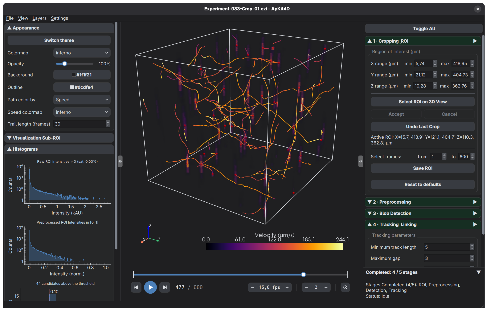

# ApKit4D

An application for visualizing and analyzing 4D (3D space + time) microscopy recordings of swimming algae taken in the Zeiss [`.czi`](https://www.zeiss.com/microscopy/en/products/software/zeiss-zen/czi-image-file-format.html) format. The microorganisms are detected in 3D, their trajectories tracked across frames in order to perform a motility analysis and to extract metrics.

<!-- TODO: update the screenshot as the appearance of the app changes -->



## Getting started

First, clone this repository with `git clone https://github.com/Agile-Software-Development-2026-2027/physics-3d-group-7.git`. Make sure to run the following commands in the cloned repository.

The **recommended way** to run the app is with [uv](https://docs.astral.sh/uv/getting-started/installation/), via the command:

```bash
uv run apkit4d
```

<details>
<summary>Alternatively, it is possible to run it with standard Python.</summary>

```bash
python -m venv .venv # create a Python virtual environment
source .venv/bin/activate # activate the venv
python -m pip install --upgrade pip # install pip itself
python -m pip install . # install the project's dependencies
python -m apkit4d # run the app
# execute 'deactivate` to leave the venv
```

</details>

Running the app will show its usage:

```text
Usage: apkit4d [OPTIONS] COMMAND [ARGS]...

Options:
  --help  Show this message and exit.

Commands:
  gui       Open the ApKit4D window.
  pipeline  Analyse a recording without the GUI: detect the blobs and...
```

> [!TIP]
> Use `--help` with a subcommand to show what it accepts, e.g. `uv run apkit4d pipeline --help`.

### Install on Linux desktop

To install ApKit4D as a desktop app run:

```bash
scripts/install.sh install
```

This will install ApKit4D as a `uv tool`, and will add the `.desktop` entry and app icon under the `$HOME/.local` of the current user.

To uninstall everything run:

```bash
scripts/install.sh uninstall
```

After installation the `apkit4d` executable will be available[^1].

[^1]: It will also be possible to run it as a uv tool from anywhere: `uv tool run apkit4d`.

> [!WARNING]
> If `$HOME/.local/bin` is not in `$PATH` none of this will work.

### How to update the app

To get the latest changes run

```bash
git pull
```

and restart or reinstall the app with the updated sources.

## How we work

- `main` is protected: nobody can push to it, every change goes through a pull request.
- Branches are short-lived (less than a day) and pull requests are small (less than 200 lines).
- A pull request needs the approval of a teammate and a green CI, and must be up to date with
  `main`. It is merged with a squash merge.
- The backlog and the sprints are on the Jira board of the team, not in this repository.
- The title of a pull request starts with the key of the Jira issue it implements:
  `ABC-12 Add the login form`.
- If `main` is red, fixing it comes before anything else.

## CI

`.github/workflows/ci.yml` runs on every pull request. It starts empty and always passes: add
the steps that build and test the project as soon as there is something to test.
